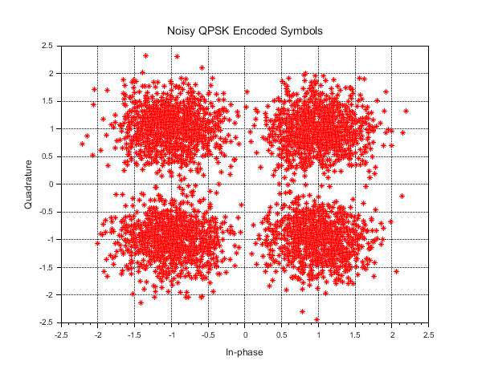
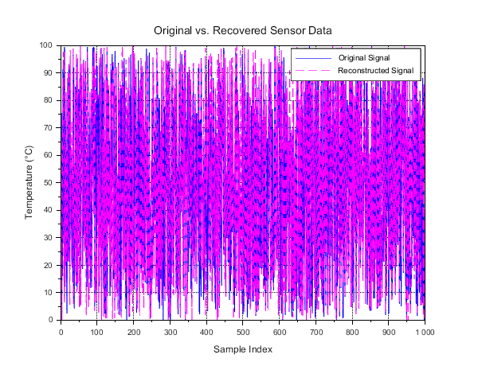
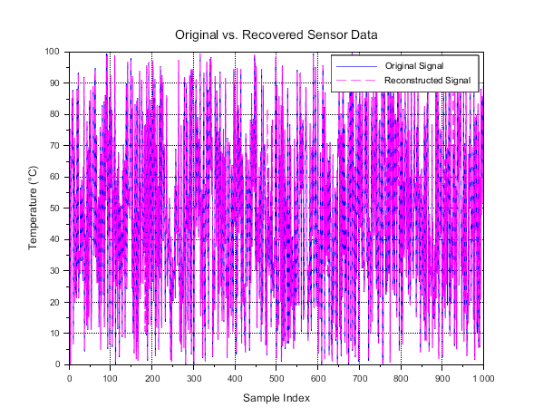

# Ground-Based Telemetry Communication using PCM and QPSK

A Scilab simulation of a sensor telemetry link: temperature readings are digitised with 8-bit PCM, sent as raw bits or as Gray-coded QPSK over a noisy channel, and recovered at the receiver.

| | |
|---|---|
| Stack | Scilab |
| Type | Course simulation, 2024 to 2025 |
| Course | 21ECC302T, SRM Institute of Science and Technology |
| Status | Both scripts run and produce plots and bit error rate |
| Hardware | None, simulation only |

## Why it exists

A ground sensor has to send readings over a noisy radio link. Bit errors in a PCM stream corrupt the recovered value. This simulation shows how much a QPSK link with decisions per symbol reduces those errors compared with sending raw bits through the same kind of noise.

## How it works

* `PCM.sci`: PCM bits are sent directly as 0 and 1 levels, noise is added, and each bit is decided by rounding.
* `PCM+QPSK.sci`: the same bits are mapped in pairs to QPSK symbols with Gray coding (00, 01, 11, 10 map to the four corners), noise is added to both parts of each symbol, and each symbol is decided by its quadrant.

Both scripts use a fixed SNR of 6 dB, 1000 samples and 8 bits per sample.

## Results

At SNR 6 dB, as recorded in the project report (one run of each script):

| Scheme | Bit error rate | Mean squared error |
|---|---|---|
| PCM alone, bits as 0 and 1 levels | 0.155625 | 239.24 |
| PCM with Gray-coded QPSK | 0.00225 | 5.97 |

Results change from run to run because the noise is random. The Scilab scripts print the figures for each run.

A re-run check: I reimplemented the same two models in Python and averaged 200 runs. QPSK came out at about 0.002, in line with the report. PCM alone came out at about 0.08, roughly half the report's single-run figure. So the direction and the large gap between the two schemes hold, but the exact PCM figure depends on the run and I could not reproduce 0.156 as a typical value.

PCM alone, original and recovered signal. The recovered line scatters where bit errors corrupt a value.

PCM with QPSK, same comparison. The recovered line follows the original closely.

The other output plots are in `PCM Output.7z` and `QPSK + PCM Output.7z`.

## Run it

1. Install [Scilab](https://www.scilab.org/).
2. Open `PCM.sci` or `PCM+QPSK.sci` in the Scilab editor and run it.
3. Read the bit error rate and mean squared error from the console, and the plots from the graphics windows.

## Limits and next steps

* A single SNR point, not a sweep. This is not a bit error rate against Eb/N0 curve.
* The two scripts scale their signals differently (0 and 1 levels for PCM, plus and minus 1 for QPSK), so the comparison shows the two simulations as written, not a controlled test at equal energy per bit.
* Hard decisions only, with no channel coding.
* Next: sweep SNR, plot the curves, and compare against the theoretical QPSK bit error rate.

## Credits

Team course project for 21ECC302T Analog and Digital Communication, SRM Institute of Science and Technology, 2024 to 2025.

## Licence

Not yet chosen.
